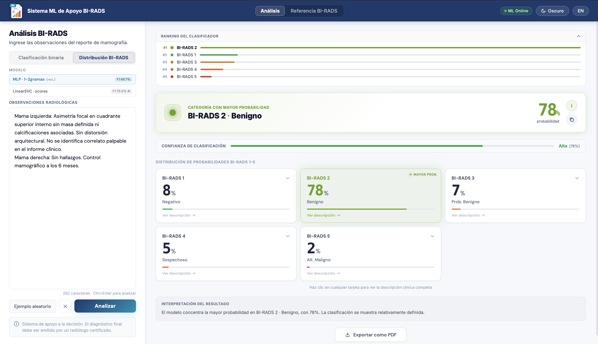

# BI-RADS-ML

Aplicación web experimental que clasifica texto libre de reportes mamográficos en español mediante **TF-IDF y aprendizaje automático**. El proyecto integra el flujo completo: preparación de datos, evaluación de modelos, API de inferencia, interfaz bilingüe y despliegue con Docker.

**[Probar la demo](https://birads-ml-uam-azc.al-miniserver.dev)** · [Ver el evento ICOKG 2026](https://ontologica.cs.buap.mx/icokg2026/)

> [!IMPORTANT]
> Este es un prototipo académico, no un dispositivo médico ni un sistema clínicamente validado. Sus resultados no deben utilizarse para diagnosticar, descartar hallazgos o decidir el manejo de pacientes. La interpretación corresponde a personal médico calificado.



## Qué demuestra el proyecto

- Procesamiento de lenguaje natural aplicado a reportes médicos en español.
- Comparación de 25 combinaciones de modelos y representaciones de texto.
- Validación cruzada estratificada de las configuraciones finalistas.
- API REST en Flask con validación de entrada e inferencia sobre modelos persistidos.
- Interfaz React responsiva, bilingüe y sin paso de compilación.
- Despliegue reproducible con Gunicorn y Docker.

## Resultados experimentales

El corpus final contiene **3,386 reportes** en las categorías BI-RADS 1 a 5. Para la evaluación inicial se utilizó una partición estratificada 80/20: 2,708 registros de entrenamiento y 678 de prueba. El vectorizador TF-IDF se ajustó únicamente con los datos de entrenamiento.

| Configuración | Evaluación | F1-macro |
|---|---:|---:|
| LinearSVC + TF-IDF de 1–2 gramas | Conjunto de prueba fijo | **0.7941** |
| LinearSVC + TF-IDF de 1–2 gramas | Validación cruzada estratificada de 5 pliegues | **0.7329 ± 0.0348** |
| MLP + TF-IDF de 1–2 gramas | Conjunto de prueba fijo | 0.6668 |

El resultado del conjunto fijo fue más favorable que el promedio de validación cruzada. Además, el corpus está desbalanceado —BI-RADS 2 representa 77.82% de los registros y BI-RADS 5 solo cuenta con 16 ejemplos—, por lo que el F1-macro y los resultados por clase son más informativos que la exactitud global.

La interfaz ofrece dos formas de exploración:

| Modo | Salida |
|---|---|
| Distribución BI-RADS | Valores para las categorías dentro del alcance del modelo (1–5) |
| Clasificación binaria A | BI-RADS 1–3 frente a BI-RADS 4–5 |
| Clasificación binaria B | BI-RADS 1–2 frente a BI-RADS 3–5 |

La MLP es la opción predeterminada en la vista de distribución porque expone `predict_proba`; esto **no significa que sea el modelo con mayor F1-macro**. LinearSVC obtuvo el mejor resultado experimental y su interfaz muestra un ranking basado en la función de decisión. Los porcentajes normalizados de LinearSVC no son probabilidades calibradas.

## Arquitectura

```text
Reporte en español
       │
       ▼
Validación y limpieza de texto
       │
       ▼
Vectorización TF-IDF
       │
       ▼
MLP / LinearSVC
       │
       ▼
API Flask ─────────► Interfaz React
```

```text
birads-ml/
├── backend/
│   ├── app.py               # API REST y servidor de archivos estáticos
│   ├── predictor.py         # Preprocesamiento y motor de inferencia
│   └── requirements.txt
├── frontend/
│   ├── index.html
│   ├── css/
│   ├── src/                 # Componentes React y utilidades
│   └── assets/logos/
├── models/
│   ├── modelos_5clases/
│   ├── modelos_binarios/
│   └── vectorizadores/
└── Dockerfile
```

## Ejecución local

Requiere Python 3.9 o posterior.

```bash
git clone https://github.com/dev1206al/birads-ml.git
cd birads-ml

python -m venv .venv
source .venv/bin/activate        # macOS / Linux
# .venv\Scripts\activate       # Windows PowerShell

pip install -r backend/requirements.txt
cd backend
python app.py
```

La aplicación estará disponible en [http://localhost:8000](http://localhost:8000). El backend sirve la interfaz, por lo que no hace falta iniciar un segundo servidor.

Para usar otro puerto:

```bash
PORT=8080 python app.py
```

### Docker

```bash
docker build -t birads-ml .
docker run --rm -p 8001:8001 birads-ml
```

La aplicación estará disponible en [http://localhost:8001](http://localhost:8001).

## API

### Consultar modelos disponibles

```bash
curl http://localhost:8000/api/catalog
```

### Solicitar una clasificación

```bash
curl -X POST http://localhost:8000/api/predict \
  -H "Content-Type: application/json" \
  -d '{
    "text": "Texto completo de observaciones de un reporte mamográfico...",
    "mode": "proba",
    "model_key": "mlp_1-2gramas"
  }'
```

Parámetros principales:

| Campo | Valores | Descripción |
|---|---|---|
| `text` | cadena | Observaciones del reporte; es obligatorio |
| `mode` | `proba` o `binary` | Tipo de salida |
| `option` | `A` o `B` | División de clases en modo binario |
| `model_key` | clave del catálogo | Modelo solicitado; es opcional |

También están disponibles `GET /api/metrics` y `GET /api/catalog`.

## Metodología y reproducibilidad

Durante el desarrollo se compararon LinearSVC, regresión logística, ComplementNB, Random Forest y MLP con distintas configuraciones de n-gramas. El preprocesamiento elimina etiquetas BI-RADS explícitas antes de la inferencia para reducir atajos evidentes en el texto.

Este repositorio publica la aplicación y los artefactos necesarios para ejecutar la inferencia. El corpus original y los scripts completos de entrenamiento no forman parte de esta versión pública, por lo que los resultados reportados no pueden reproducirse de extremo a extremo únicamente con el contenido del repositorio.

Los archivos `.pkl` deben cargarse solo desde este repositorio o desde una fuente confiable; el formato `pickle` puede ejecutar código durante la deserialización.

## Limitaciones

- El modelo fue entrenado con reportes procedentes de un contexto institucional específico y no se evaluó externamente.
- El conjunto tiene un fuerte desbalance de clases y muy pocos ejemplos de BI-RADS 5.
- La aplicación procesa exclusivamente texto; no analiza mamografías ni otras imágenes médicas.
- Las salidas de LinearSVC representan distancias a hiperplanos, no probabilidades calibradas.
- Una clasificación negativa no descarta hallazgos y una positiva no confirma enfermedad.
- BI-RADS 0 y 6 se muestran como referencia, pero quedan fuera del alcance predictivo.

## Presentación y publicación

El trabajo **“Clasificación automática de reportes mamográficos en español basada en BI-RADS mediante aprendizaje automático”** fue presentado en la **5th International Conference on Ontologies and Knowledge Graphs (ICOKG 2026)**, en la BUAP.

El artículo fue aceptado para publicación como capítulo de libro con ISBN y se encuentra pendiente de publicación. Esta afirmación no implica aceptación en una revista científica ni validación clínica del sistema.

## Autor

**Luis Enrique Alvarez Segura**<br>
Ingeniería en Computación, Universidad Autónoma Metropolitana<br>
[LinkedIn](https://www.linkedin.com/in/luis-enrique-alvarez-segura) · [GitHub](https://github.com/dev1206al)

## Licencia

Este repositorio todavía no declara una licencia de uso. El código permanece bajo los derechos de sus autores hasta que se agregue una licencia explícita.
